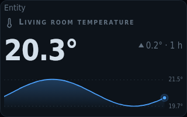
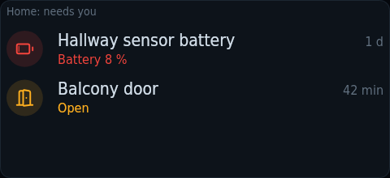

# kiosko-plugin-homeassistant

Home Assistant on the panel, live over its WebSocket API: any entity in big with its history, lists of entities, and what needs you at home (doors left open, low batteries, leaks, the alarm).

A plugin for [Kiosko](https://github.com/kiosko-lcd/kiosko), the widget mosaic for small USB LCD panels.



## Install

In Kiosko, **Plugins → Install from npm** → `kiosko-plugin-homeassistant`, then restart Kiosko. Or from a terminal:

```sh
npm install --prefix ~/.config/kiosko/plugins kiosko-plugin-homeassistant
```

(macOS: `~/Library/Application Support/Kiosko/plugins`, Windows: `%APPDATA%\Kiosko\plugins`.)

## Requirements

- Home Assistant reachable from this machine, and a long-lived access token: in Home Assistant, your profile → *Security* → *Long-lived access tokens* → *Create token*. A user that is not an administrator is enough.
- Node 22 or newer (its built-in WebSocket); no other dependency.

## What it does on your machine

- **Internet**: contacts the ones you set in its options.

## Widgets

### Entity — `homeassistant/entity`

One Home Assistant entity in big: a temperature, the power the house draws, a door, the thermostat. Numeric sensors can show their last hours as bars, and turn amber or red past thresholds of your own.


Uses: `homeassistant/states`.

| Option | Type | Default | |
|---|---|---|---|
| `entity` | string | `""` | Entity. Its id, as in Home Assistant → Settings → Devices & services → Entities. |
| `name` | string | `""` | Name. Empty = the name in Home Assistant. |
| `showName` | boolean | `true` | Show the name |
| `showHistory` | boolean | `true` | Show the history. Numeric sensors only, when the source keeps their history. |
| `historyMs` | duration (ms) | `86400000` | History span |
| `decimals` | number | `-1` | Decimals. -1 = automatic: fewer as the number grows. |
| `thresholds` | `off` \| `above` \| `below` | `"off"` | Thresholds |
| `warn` | number | `0` | Warning (amber) at |
| `alert` | number | `0` | Alert (red) at. Red, and the widget keeps its tile. |

### Entities — `homeassistant/entities`

A list of Home Assistant entities and their states, picked by id or name with patterns (sensor.*_temperature, light.*). Open doors, low batteries and alarms are coloured; the rest stays quiet.


Uses: `homeassistant/states`.

| Option | Type | Default | |
|---|---|---|---|
| `rows` | number | `0` | Rows. 0 = as many as fit. A number shows that many, in rows of a readable size (fewer when the tile is too small for them); the rest are counted in "+N more". |
| `layout` | `auto` \| `one-line` \| `detailed` | `"auto"` | Row layout. Automatic: the widget picks by the tile's shape. |
| `entities` | list | `[]` | Entities. Ids or names, in the order to list them: sensor.*_temperature, light.*, *kitchen*, !light.porch. Empty = all. |
| `hideOff` | boolean | `false` | Only what is on, open or wrong. Leaves out what is off or closed. Numbers always stay. |
| `hideUnavailable` | boolean | `false` | Hide unavailable entities |
| `decimals` | number | `-1` | Decimals. -1 = automatic. |
| `batteryWarn` | number | `20` | Battery warning at |
| `batteryAlert` | number | `10` | Battery alert at |

### Home: needs you — `homeassistant/attention`

Only what needs you at home: smoke, a leak or the alarm in red (and it keeps its tile until they stop), then doors and windows left open, unlocked locks, low batteries and problems. Hides itself when all is well.



Uses: `homeassistant/states`.

| Option | Type | Default | |
|---|---|---|---|
| `rows` | number | `0` | Rows. 0 = as many as fit. A number shows that many, in rows of a readable size (fewer when the tile is too small for them); the rest are counted in "+N more". |
| `layout` | `auto` \| `one-line` \| `detailed` | `"auto"` | Row layout. Automatic: the widget picks by the tile's shape. |
| `entities` | list | `[]` | Entities. Empty = all. Leave out the ones that are fine open with !: !binary_sensor.patio_door. |
| `includeOpenings` | boolean | `true` | Doors, windows and locks. Open doors, windows, garage doors and gates; unlocked locks. |
| `openMs` | duration (ms) | `0` | Open for at least. A door counts once it has been open this long. 0 = at once. |
| `includeBatteries` | boolean | `true` | Low batteries |
| `includeProblems` | boolean | `true` | Problems. Problem and tamper sensors, lost connections, a vacuum in error. |
| `includeUnavailable` | boolean | `false` | Unavailable devices |
| `includeUpdates` | boolean | `false` | Updates available |
| `batteryWarn` | number | `20` | Battery warning at |
| `batteryAlert` | number | `10` | Battery alert at |

## Data sources

### Home Assistant — `homeassistant/states`

The states of your Home Assistant entities, live over its WebSocket API (a change shows at once), and the last day of the numeric sensors for the history bars. Options are set once in Kiosko → Settings → Data sources.

| Option | Type | Default | |
|---|---|---|---|
| `url` | string | `""` | Home Assistant address. The one you open in the browser, e.g. http://homeassistant.local:8123 or https://home.example.com. |
| `token` | string | *(secret)* | Long-lived access token. In Home Assistant: your profile → Security → Long-lived access tokens → Create token. A user that is not an administrator is enough. |
| `entities` | list | `[]` | Entities to read. Empty = all. Ids or names, with * and !: sensor.*, binary_sensor.*, lock.*, !sensor.*_linkquality. |
| `history` | list | `[]` | Entities with history. Numeric sensors whose last day is kept for the history bars. Empty = every one with a unit. |
| `maxHistory` | number | `100` | Most entities with history. Each costs a day of five-minute averages in memory (about 300 numbers). 0 = no history. |

## Development

```sh
npm install
npm test          # node:test
npm run check     # TypeScript
npm run build     # dist/index.js, what Kiosko loads
```

To try it in a running Kiosko without publishing: `kiosko plugins link .` and restart Kiosko.

Working on Kiosko and its plugins together: clone them side by side
(`kiosko/` and `kiosko-plugins/kiosko-plugin-homeassistant/`) and run `npm install` in
`kiosko/`; its workspaces link every plugin found in `../kiosko-plugins`.

## License

MIT
