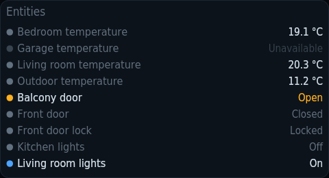
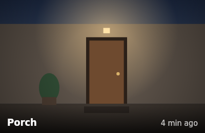
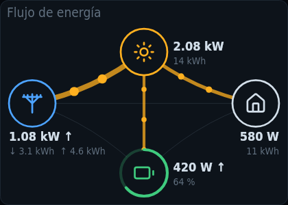
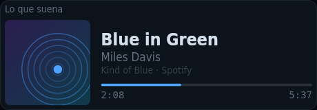
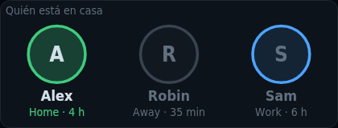

# kiosko-plugin-homeassistant

Home Assistant on the panel, live over its WebSocket API: any entity in big with its history, lists of entities, what needs you at home (doors left open, low batteries, leaks, the alarm), your cameras (with the doorbell), the energy flow, what's playing and who is home.

A plugin for [Kiosko](https://github.com/kiosko-lcd/kiosko), the widget mosaic for small USB LCD panels.


## Install

In Kiosko, **Plugins → Install from npm** → `kiosko-plugin-homeassistant`, then restart Kiosko. Or from a terminal:

```sh
npm install --prefix ~/.config/kiosko/plugins kiosko-plugin-homeassistant
```

(macOS: `~/Library/Application Support/Kiosko/plugins`, Windows: `%APPDATA%\Kiosko\plugins`.)

## Requirements

- Home Assistant reachable from this machine, and a long-lived access token: in Home Assistant, your profile → *Security* → *Long-lived access tokens* → *Create token*. A user that is not an administrator is enough.
- Node 22 or newer (its built-in WebSocket); no other dependency.

## What it does on your machine

- **Internet**: contacts the ones you set in its options.

## Widgets

### Entity — `homeassistant/entity`

One Home Assistant entity in big: a temperature, the power the house draws, a door, the thermostat. Numeric sensors can show their last hours as bars, and turn amber or red past thresholds of your own.


Uses: `homeassistant/states`.

| Option | Type | Default | |
|---|---|---|---|
| `entity` | string | `""` | Entity. Its id, as in Home Assistant → Settings → Devices & services → Entities. |
| `name` | string | `""` | Name. Empty = the name in Home Assistant. |
| `showName` | boolean | `true` | Show the name |
| `showHistory` | boolean | `true` | Show the history. Numeric sensors only, when the source keeps their history. |
| `historyMs` | duration (ms) | `86400000` | History span |
| `decimals` | number | `-1` | Decimals. -1 = automatic: fewer as the number grows. |
| `thresholds` | `off` \| `above` \| `below` | `"off"` | Thresholds |
| `warn` | number | `0` | Warning (amber) at |
| `alert` | number | `0` | Alert (red) at. Red, and the widget keeps its tile. |

### Entities — `homeassistant/entities`

A list of Home Assistant entities and their states, picked by id or name with patterns (sensor.*_temperature, light.*). Open doors, low batteries and alarms are coloured; the rest stays quiet.



Uses: `homeassistant/states`.

| Option | Type | Default | |
|---|---|---|---|
| `rows` | number | `0` | Rows. 0 = as many as fit. A number shows that many, in rows of a readable size (fewer when the tile is too small for them); the rest are counted in "+N more". |
| `layout` | `auto` \| `one-line` \| `detailed` | `"auto"` | Row layout. Automatic: the widget picks by the tile's shape. |
| `entities` | list | `[]` | Entities. Ids or names, in the order to list them: sensor.*_temperature, light.*, *kitchen*, !light.porch. Empty = all. |
| `hideOff` | boolean | `false` | Only what is on, open or wrong. Leaves out what is off or closed. Numbers always stay. |
| `hideUnavailable` | boolean | `false` | Hide unavailable entities |
| `decimals` | number | `-1` | Decimals. -1 = automatic. |
| `batteryWarn` | number | `20` | Battery warning at |
| `batteryAlert` | number | `10` | Battery alert at |

### Home: needs you — `homeassistant/attention`

Only what needs you at home: smoke, a leak or the alarm in red (and it keeps its tile until they stop), then doors and windows left open, unlocked locks, low batteries and problems. Hides itself when all is well.


Uses: `homeassistant/states`.

| Option | Type | Default | |
|---|---|---|---|
| `rows` | number | `0` | Rows. 0 = as many as fit. A number shows that many, in rows of a readable size (fewer when the tile is too small for them); the rest are counted in "+N more". |
| `layout` | `auto` \| `one-line` \| `detailed` | `"auto"` | Row layout. Automatic: the widget picks by the tile's shape. |
| `entities` | list | `[]` | Entities. Empty = all. Leave out the ones that are fine open with !: !binary_sensor.patio_door. |
| `includeOpenings` | boolean | `true` | Doors, windows and locks. Open doors, windows, garage doors and gates; unlocked locks. |
| `openMs` | duration (ms) | `0` | Open for at least. A door counts once it has been open this long. 0 = at once. |
| `includeBatteries` | boolean | `true` | Low batteries |
| `includeProblems` | boolean | `true` | Problems. Problem and tamper sensors, lost connections, a vacuum in error. |
| `includeUnavailable` | boolean | `false` | Unavailable devices |
| `includeUpdates` | boolean | `false` | Updates available |
| `batteryWarn` | number | `20` | Battery warning at |
| `batteryAlert` | number | `10` | Battery alert at |

### Camera — `homeassistant/camera`

The latest picture of a Home Assistant camera (Blink, Reolink, ONVIF…), refreshed every minute, with how old it is; with a motion sensor, a red mark while it sees someone, and it can take over its tile. A still, not live video.



Uses: `homeassistant/states`.

The picture is read from Home Assistant's camera proxy with the camera's own short-lived token (the one in its `entity_picture`, renewed by Home Assistant every few minutes): your long-lived token stays in the source. What the picture is depends on the camera: a fresh still for one that streams; for a battery camera like **Blink**, the last thumbnail it took (on motion, or when asked with Home Assistant's `blink.trigger_camera`), so the age tells how old it is. "Keep the tile while urgent" is off by default: turn it on to have the camera take over its tile while its motion sensor is on or for a minute after the doorbell rings. While someone moves or rings, the picture is read every 10 s.

| Option | Type | Default | |
|---|---|---|---|
| `entity` | string | `""` | Camera. Its id in Home Assistant: camera.something. |
| `name` | string | `""` | Name. Empty = the name in Home Assistant. |
| `showName` | boolean | `true` | Show the name |
| `showAge` | boolean | `true` | Show how old the picture is. Since the picture last changed. A battery camera (Blink) only takes a new one on motion or when asked. |
| `motion` | string | `""` | Motion sensor. Empty = binary_sensor.<camera>_motion if there is one (Blink names them so). |
| `doorbell` | string | `""` | Doorbell. An event entity (event.*) or a binary sensor: for a minute after it rings, a mark on the picture, and the camera takes the tile if allowed. |
| `fit` | `cover` \| `contain` | `"cover"` | Fit |
| `keep` | `center` \| `top` \| `bottom` | `"center"` | Keep in view. What filling crops last: the sky or the ground. |
| `dim` | number | `0` | Darken. Keeps a bright picture from outshining everything else. |

### Energy flow — `homeassistant/energy`

Where the power comes from and goes, now: the grid, the solar panels and the battery around the house, a line for every flow (thicker the more it carries, with dots running along it) and today's kWh from the Energy dashboard. A grid sensor is enough to start.



Uses: `homeassistant/states`. Today's energy is read from the statistics of Home Assistant's **Energy dashboard** (every 5 minutes, only when it is set up); the power sensors are the ones chosen here or, when none is, the ones set in the dashboard (Home Assistant 2025.12 and later).

| Option | Type | Default | |
|---|---|---|---|
| `grid` | string | `""` | Grid power. W or kW, positive while buying. Empty = the one in the Energy dashboard. |
| `gridExportPositive` | boolean | `false` | The grid sensor is positive while selling |
| `solar` | string | `""` | Solar power. Empty = the one in the Energy dashboard, or none. |
| `battery` | string | `""` | Battery power. Positive while discharging. Empty = the one in the Energy dashboard, or none. |
| `batteryChargePositive` | boolean | `false` | The battery sensor is positive while charging |
| `batteryLevel` | string | `""` | Battery level. Its %, shown in the battery. |
| `showToday` | boolean | `true` | Today's energy. From the Energy dashboard, under each part. |
| `moving` | boolean | `true` | Moving dots. Repaints the tile every second. |

### Now playing — `homeassistant/media`

What a Home Assistant media player is playing (the TV, Spotify on a speaker, a Chromecast, Sonos…): cover, title, artist, the app and how far it has got. Of several, the one playing. Hides itself while nothing plays.



Uses: `homeassistant/states`. The cover comes from Home Assistant's media player proxy, with the player's own short-lived token, and is read again only when the track changes.

| Option | Type | Default | |
|---|---|---|---|
| `entity` | string | `""` | Player. One, or several with patterns (media_player.*, !media_player.kitchen): the one playing is shown. Empty = all. |
| `showCover` | boolean | `true` | Show the cover |
| `showProgress` | boolean | `true` | Show how far it has got |

### Who is home — `homeassistant/people`

The people Home Assistant knows, with their photo: at home, away or in a zone of yours (Work, School), and since when.



Uses: `homeassistant/states`.

| Option | Type | Default | |
|---|---|---|---|
| `people` | list | `[]` | People. In this order. Empty = everyone. |
| `showSince` | boolean | `true` | Since when |
| `homeFirst` | boolean | `false` | Who is home first |

## Data sources

### Home Assistant — `homeassistant/states`

The states of your Home Assistant entities, live over its WebSocket API (a change shows at once), and the last day of the numeric sensors for the history bars. Options are set once in Kiosko → Settings → Data sources.

| Option | Type | Default | |
|---|---|---|---|
| `url` | string | `""` | Home Assistant address. The one you open in the browser, e.g. http://homeassistant.local:8123 or https://home.example.com. |
| `token` | string | *(secret)* | Long-lived access token. In Home Assistant: your profile → Security → Long-lived access tokens → Create token. A user that is not an administrator is enough. |
| `entities` | list | `[]` | Entities to read. Empty = all. Ids or names, with * and !: sensor.*, binary_sensor.*, lock.*, !sensor.*_linkquality. |
| `history` | list | `[]` | Entities with history. Numeric sensors whose last day is kept for the history bars. Empty = every one with a unit. |
| `maxHistory` | number | `100` | Most entities with history. Each costs a day of five-minute averages in memory (about 300 numbers). 0 = no history. |

## Development

```sh
npm install
npm test          # node:test
npm run check     # TypeScript
npm run build     # dist/index.js, what Kiosko loads
```

To try it in a running Kiosko without publishing: `kiosko plugins link .` and restart Kiosko.

Working on Kiosko and its plugins together: clone them side by side
(`kiosko/` and `kiosko-plugins/kiosko-plugin-homeassistant/`) and run `npm install` in
`kiosko/`; its workspaces link every plugin found in `../kiosko-plugins`.

## License

MIT
